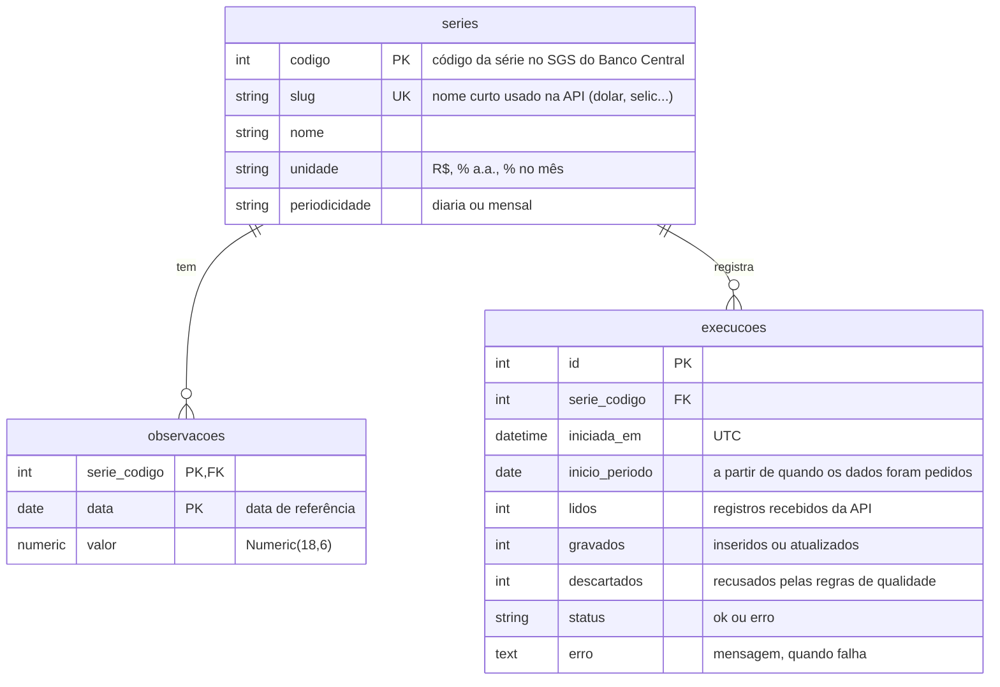

# Esquema do banco

Três tabelas, definidas em [`src/indicadores/load.py`](../src/indicadores/load.py). São criadas sozinhas na primeira execução do pipeline.

## Regras

- **`observacoes`** guarda os valores. A chave `(serie_codigo, data)` impede valor duplicado no mesmo dia; uma nova gravação na mesma data **atualiza** o valor.
- **`series`** é o catálogo. Ela vem de `config.py` e é atualizada a cada execução, então mudar o nome de um indicador no código muda no banco também.
- **`execucoes`** só recebe linhas novas, nunca é alterada. Uma linha por série a cada vez que a API é consultada, com sucesso ou erro. Se a série já tem o valor de hoje, a API nem é chamada e nada é registrado.

## Consultas que a API faz

| Rota | Consulta |
| --- | --- |
| `/series` | último valor de cada série (máximo de `data` por série, juntando com `observacoes`) |
| `/series/{slug}` | valores entre duas datas, em ordem |
| `/series/{slug}/ultimo` | maior `data` da série |
| `/execucoes` | últimas linhas de `execucoes` com o `slug` da série |
